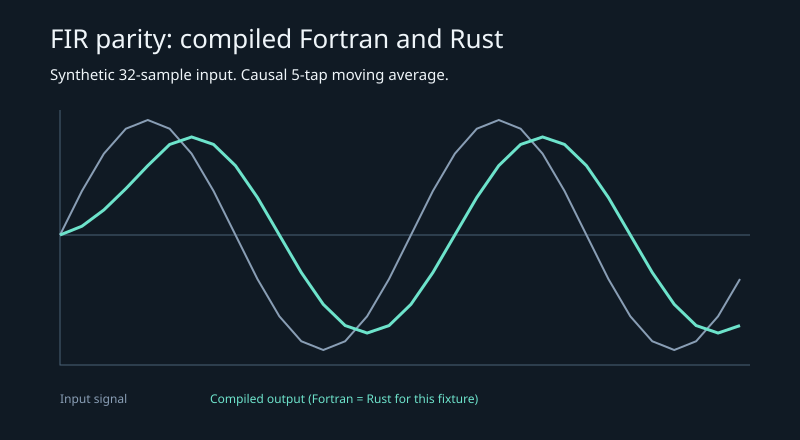

# FIR parity — Fortran and Rust, real compilers

Two independent implementations of the same causal FIR filter, built by **gfortran** and **rustc**, compared sample-by-sample against each other and against a Python reference.

```sh
python tools/make_fixtures.py
python tools/fir_parity.py
python -m pytest -q
```

Latest local run (gfortran 16.2, rustc 1.99.1, Windows): **32 samples, maximum Fortran↔Rust difference 0.0, maximum Fortran↔reference difference 0.0**, all fixtures within `1e-12`.



This is the FIR extension preserved from the earlier signal-migration idea: the orbital port moved on, the filter parity work did not.

## Data format

Both binaries take the same three arguments: `fir <taps> <signal> <output>`.

```
5
0.2
0.2
0.2
0.2
0.2
```

- First line: decimal digit count, at most 1,000,000. At least one tap.
- Remaining lines: exactly one finite decimal or E-notation value per line. No blank lines, comma-separated lists or trailing rows.
- Output: count on the first line, then one `ES24.16E3` / `{:.16e}` value per line.

The filter is causal and zero-pads history:

```
y[i] = sum(k = 0 .. m-1) taps[k] * x[i-k]   for i-k >= 0
```

## Edge cases covered

| Case | Behaviour |
| --- | --- |
| Signal shorter than taps | partial sums, zero-padded history |
| Impulse | first `m` outputs equal the taps |
| Constant signal | converges to `sum(taps) × value` |
| Single tap | scaled copy of the signal |
| Empty signal | header `0`, no values |
| Zero taps | both binaries exit non-zero |
| Non-numeric input | both binaries exit non-zero |

## Verification

26 tests:

- builds both binaries with the real compilers;
- sine, short, impulse, constant and single-tap parity;
- empty signal;
- zero-tap and invalid-number rejection;
- an independent Python reference.

The harness records `reports/parity.json`; `tools/fir_parity.py` prints the same JSON.

## Build

```sh
gfortran -O2 -std=f2008 -Wall -static -o build/fir_fortran fortran/fir.f90
rustc -O -o build/fir_rust rust/fir.rs
```

`tools/fir_parity.py` finds `gfortran` on `PATH`, via `GFORTRAN`, or in the WinLibs winget package, and prefers the GNU Rust toolchain on Windows because it can link with the MinGW linker.

## Limits

- One causal, real-valued FIR. No decimation, interpolation, block processing, SIMD or multichannel support.
- The Fortran binary is statically linked for portability in this environment; that is a build choice, not a performance claim.
- This is not a benchmark. No timing, throughput or numerical-accuracy comparison beyond exact fixture parity is claimed.
- Floating-point agreement is expected because both use IEEE-754 doubles and the same accumulation order; a different order could change the last bits.
- Fixtures are synthetic.

## CI

Ubuntu runners install `gfortran` and use the preinstalled Rust toolchain, then run the same tests. The boundary tests require both compilers, so a missing toolchain fails CI.

MIT — see [LICENSE](LICENSE).

## Audit corrections

The harness checks output count against the independent reference, not only agreement between the two binaries. This prevents two equally truncated outputs from passing. Both programs reject non-finite values, overflow, extra/missing rows, oversized counts and work above 20 million tap/sample products. Outputs must name a new file, so an existing input or result cannot be overwritten. The harness reuses only its named intermediate output files.

Five seeded random signed signal/tap scenarios supplement impulse, step-like constant, short, single-tap and empty inputs. Builds refresh when sources change. No runtime speedup or accuracy beyond the tested absolute tolerance is claimed. Actual compiler versions are recorded in `reports/toolchains.json`.
